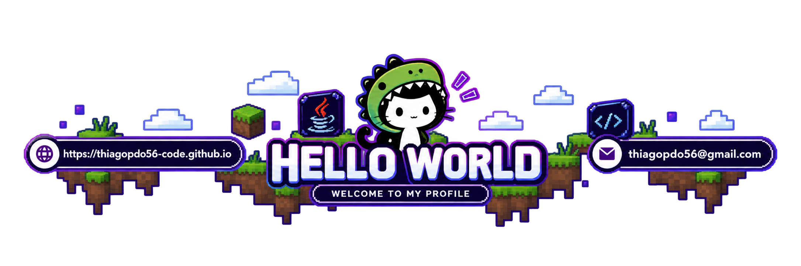

<!-- BANNER PERSONALIZADO HELLO WORLD -->

<!-- ONDA AZUL E ROXA ABAIXO DO BANNER -->
<!-- TEXTO ANIMADO -->

  

<!-- VISITAS E SEGUIDORES -->

&nbsp;

  

<!-- ESTATÍSTICAS DO GITHUB -->

  

<!-- TECNOLOGIAS -->

  

<!-- LINGUAGENS MAIS USADAS -->

  

<!-- REDES SOCIAIS -->

&nbsp;&nbsp;&nbsp;

  

<!-- MENSAGEM FINAL ANIMADA -->

<!-- RODAPÉ COM ONDA AZUL E ROXA -->

